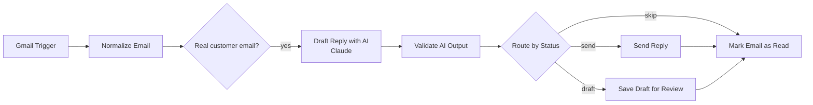

# AI Email Support & Sales Agent (n8n + Gmail + Claude)

AI-powered email support and sales automation built with **n8n**, **Gmail**, and **Claude AI**. It automatically classifies incoming emails, generates professional customer replies, filters spam, validates every AI response, and routes each message for automatic sending or human review. Simplify customer communication and streamline your sales workflow.

---

## Features

- **Automatic email handling:** polls Gmail every minute for new unread customer emails.
- **Smart filtering:** skips no-reply senders, newsletters, auto-replies, and Gmail Promotions/Social/Updates/Forums.
- **AI classification:** labels each email with an `intent` (service inquiry, pricing, complaint, spam, and more) and a `lead_status`.
- **AI-written replies:** short, friendly, professional replies that include your contact details and use only your verified business information.
- **Strict output validation:** a code node checks the AI's JSON before anything is sent.
- **Safe routing:** send automatically, save as a Gmail draft for human review, or skip.
- **Prompt-injection resistant:** customer emails are passed as untrusted data inside `<email>` tags, separate from the system prompt.
- **No duplicate replies:** processed emails are marked as read, and your own outgoing mail is excluded.

---

## How It Works



### Nodes

| Node | Purpose |
|------|---------|
| **Gmail Trigger** | Polls every minute for unread inbox mail (max 5 per poll). Query: `in:inbox -from:me -category:promotions -category:social -category:updates -category:forums` |
| **Normalize Email** | Extracts `id`, `threadId`, `fromEmail`, `subject`, `body` (first 3000 characters) and flags automated mail (`isAutomated`). |
| **Is Real Customer Email?** | Lets only genuine human emails continue. |
| **Draft Reply with AI** | Basic LLM Chain with your business info in the system prompt. Returns a JSON object. |
| **Claude Model** | Anthropic chat model used by the chain. |
| **Validate AI Output** | Parses and validates the JSON, enforces safety rules, and decides the route. |
| **Route by Status** | Splits into `send`, `draft`, or `skip`. |
| **Send Reply** | Replies to the customer in the same Gmail thread. |
| **Save Draft for Review** | Saves the reply as a Gmail draft in the same thread. |
| **Mark Email as Read** | Prevents the email from being processed again. |

---

## Routing Logic

| Situation | Result |
|-----------|--------|
| Safe reply and `AUTO_SEND_ENABLED = true` | Reply is **sent automatically** |
| `human_review = true`, or `AUTO_SEND_ENABLED = false` | Reply is **saved as a Gmail draft** |
| Spam, or no reply required | **Skipped**, email is marked as read |
| Invalid or unsafe AI output | **Nothing is sent**, email stays unread for manual handling |

---

## AI Output Format

The AI must return only valid JSON with these fields:

```json
{
  "reply_required": true,
  "auto_send": true,
  "human_review": false,
  "intent": "service_inquiry",
  "lead_status": "new",
  "reason": "Routine inquiry answered using verified information",
  "reply_subject": "Re: Original Subject",
  "reply_body": "Complete personalized email including contact details"
}
```

**Allowed `intent` values:** `service_inquiry`, `technical_question`, `pricing`, `project_request`, `existing_client_support`, `complaint`, `spam`, `marketing`, `other`

**Allowed `lead_status` values:** `new`, `qualified`, `existing_customer`, `not_a_lead`, `unknown`

---

## Validation and Safety Rules

The **Validate AI Output** node enforces these rules before any email is sent:

- The output is valid JSON and contains all 8 required fields.
- `intent` and `lead_status` are from the allowed lists.
- If `reply_required` is `false` or `human_review` is `true`, then `auto_send` is forced to `false`.
- The reply is not empty and contains your configured contact email.
- No leftover placeholders such as `[YOUR NAME]` or `{{ }}` appear in the reply.
- The reply is no longer than 200 words.
- The AI never invents prices, guarantees, credentials, services, or delivery timelines. It only uses the business info in the prompt.

---

## Requirements

- An [n8n](https://n8n.io) instance (cloud or self-hosted)
- A Gmail account with OAuth2 access
- An Anthropic API key (or n8n AI credits)

---

## Setup

1. **Import the workflow.** In n8n, go to *Workflows → Import from file* and select `workflow.json`.
2. **Connect Gmail.** Open the **Gmail Trigger** node and create or select a Gmail OAuth2 credential. Use the same credential in **Send Reply**, **Save Draft for Review**, and **Mark Email as Read**.
3. **Connect Claude.** Open the **Claude Model** node and add your Anthropic credential.
4. **Add your business info.** In **Draft Reply with AI**, edit the system prompt and fill in:
   - Business name and services
   - Contact details (name, email, WhatsApp, website, portfolio, booking link)
   - Verified pricing and policies
5. **Edit the validation config.** In **Validate AI Output**, set:
   ```js
   const AUTO_SEND_ENABLED = false;            // start with false (drafts only)
   const REQUIRED_CONTACT = 'you@example.com'; // must appear in every reply
   ```
6. **Publish** the workflow so the trigger starts polling.

> **Tip:** Start with `AUTO_SEND_ENABLED = false` for the first week or two. Review the drafts in Gmail, then switch to `true` once you trust the replies.

---

## Testing

Send these from a **different email address** to your connected inbox (not from the same account, because your own mail is excluded):

| Test | Expected result |
|------|-----------------|
| "What services do you offer?" | Reply with services and contact details |
| "How much does a chatbot cost?" | Reply that pricing is shared after a project discussion, with no invented numbers |
| A message in Roman Urdu or Urdu | Reply in the same language |
| An obvious spam message | No reply, email marked as read |
| A complaint or refund request | Saved as a draft for human review |

Check the **Executions** tab in n8n and the **Drafts** folder in Gmail.

---

## Customization

- **Change the model:** edit the **Claude Model** node.
- **Change filters:** edit the `q` query in **Gmail Trigger** and the regex in **Normalize Email**.
- **Add thread history:** add a Gmail *Get Thread* node and pass the previous messages into the prompt.
- **Notify yourself:** add a Slack, Telegram, or email node on the `draft` branch to alert you when a draft needs review.
- **Track leads:** add a Google Sheets or CRM node after validation and log `intent`, `lead_status`, and `fromEmail`.

---

## Troubleshooting

| Problem | Likely cause |
|---------|--------------|
| No executions at all | No new **unread Primary inbox** mail reached the connected Gmail account. Check the credential's account, and that the mail is unread. |
| Mail is ignored | It landed in Promotions/Spam, was sent from the same account, or came from a no-reply address. |
| Email stays unread, nothing sent | Validation failed (for example, the reply is missing your contact email). Check the `errors` array in the **Validate AI Output** output. |
| Drafts instead of sent emails | `AUTO_SEND_ENABLED` is `false`, or the AI set `human_review` to `true`. |

---

## Security Notes

- Never commit API keys, OAuth tokens, or credentials. The exported workflow contains only credential references, not secrets.
- Replace personal contact details before publishing a public copy of the workflow.
- Customer emails are treated as untrusted input and are never allowed to override the system prompt.

---

## Tech Stack

n8n · Gmail API · Claude (Anthropic) · JavaScript

---

## License

Released under the [MIT License](LICENSE). Add a `LICENSE` file to your repository.
